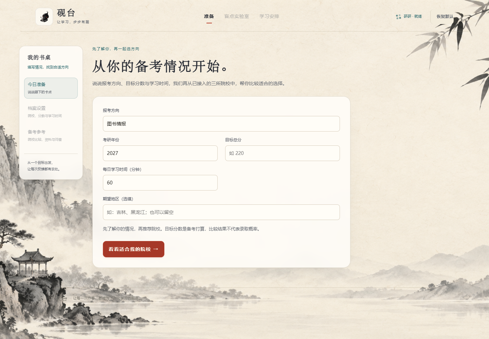
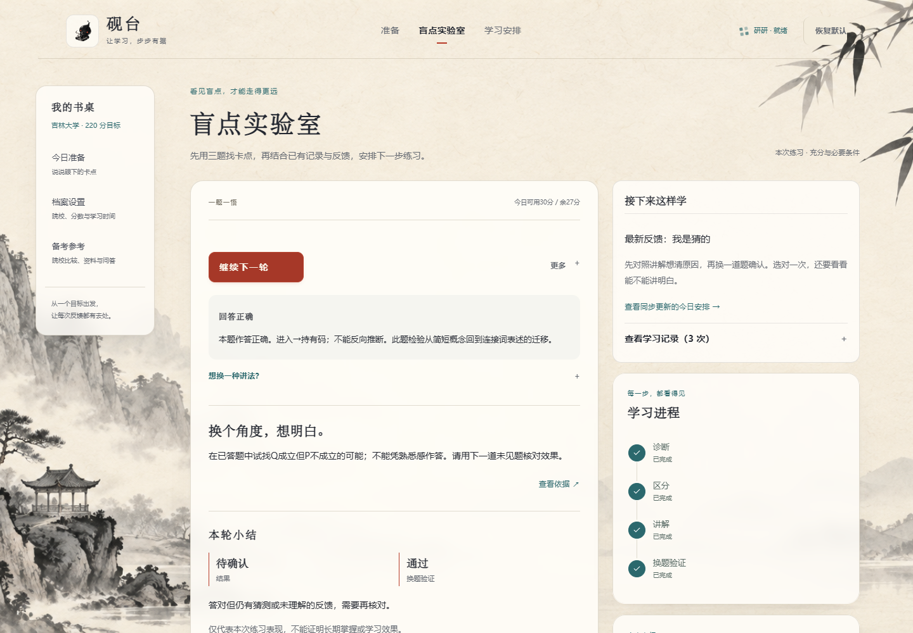

# 砚台 · YANTAI

**看见学习中的卡点，再决定下一步怎么学。**

砚台是一个面向考研备考的 Agent 应用原型。它从备考目标出发，帮助用户比较已接入的院校，再通过“诊断、区分、讲解、换题验证、反馈”的学习循环，形成有作答记录和引用依据的下一步安排。

项目关注一个具体问题：做对一道题之后，怎么确认自己真的理解了？做错时，又该练什么？砚台把每次作答、用户反馈和后续验证连起来，让学习安排有据可查。

**当前状态：功能原型，开发暂告一段落。** 本仓库保留可运行代码、实际截图和分层验证记录；尚未完成团队环境联调或真实学生学习效果验证。

## 使用流程

```text
填写备考情况 → 比较院校与来源 → 用户确认目标 → 说明今天的学习打算
                                                   ↓
                        下一步安排 ← 反馈 ← 换题验证 ← 讲解 ← 区分 ← 诊断
                            └────────── 继续下一轮 ──────────┘
```

首次使用先填写报考方向、年份、目标分数和每日学习时间。系统给出资料支持的比较结果，由用户确认目标院校；之后进入盲点实验室。练习中可以反馈“我是猜的”“还是没理解”或调整可用时间，让下一轮与当前情况衔接。

## 已实现的内容

| 能力 | 当前行为 |
| --- | --- |
| 备考准备与院校比较 | 接入吉林大学、哈尔滨工程大学、东北大学的来源快照；匹配专业后展示比较与资料缺口，由用户确认目标 |
| 盲点实验室 | 首题诊断、区分题、引用讲解、换题验证，保留本轮判断依据 |
| 反馈与学习安排 | 结合本次表现、已有记录、用户反馈和时间预算调整后续练习 |
| 受限动态出题 | live 模式在后续轮次生成逻辑候选题，经过程序校验后才进入会话题库 |
| 证据与过程展示 | 展示学习阶段、引用原文、规则来源和作答记录，不展示模型内部思考 |
| 会话恢复 | SQLite 保存会话；刷新后恢复当前进度，请求重放避免重复推进或计分 |
| 演示重置 | “恢复默认”开启空白会话；已有记录不会因此被删除 |

### 页面预览

以下是本地 mock 演示截图，展示界面与流程，不代表真实学生记录或全程真实模型调用。



<details>
<summary>查看盲点实验室与反馈联动</summary>



</details>

## 快速开始

推荐使用 **Windows、PowerShell、Python 3.11+**；已有运行验证使用 Python 3.12。首次安装依赖需要联网，mock 演示不需要模型 API key。页面构建产物已包含，直接运行无需安装 Node.js。

```powershell
git clone https://github.com/y1628456719-byte/yantai-study-agent.git
cd yantai-study-agent\edu-agent
.\Setup.ps1
.\Start.ps1 -Mode mock -Port 8790
```

打开 <http://127.0.0.1:8790/>。终端保持运行，按 `Ctrl+C` 停止服务。

要体验真实模型，先按 [运行与开发说明](edu-agent/README.md#真实模型模式) 配置自己的 AI Ping key，再运行 `Start.ps1 -Mode live -Port 8791`。live 模式会调用外部模型并消耗所配置账号的额度；调用失败不会静默切换成模拟结果。

| 模式 | 用途 | 模型调用 |
| --- | --- | --- |
| `mock` | 本地演示界面、规则分支与学习流程 | 不调用外部模型；使用固定题与模拟反馈 |
| `live` | 体验真实解释及受限动态练习 | 入口默认连接 AI Ping / DeepSeek-V4.1-Flash，使用服务端凭据 |

## 技术实现

- **后端**：Python、FastAPI、SQLite。
- **前端**：原生 JavaScript 页面与 React / TypeScript 展示组件，Motion、Radix Collapsible；构建工具为 esbuild。
- **模型适配**：模型负责受约束的解释与题目候选，程序负责状态推进、判分、引用定位、请求幂等和持久化。
- **答案与引用校验**：动态逻辑题使用有界表达式解析、真值枚举和唯一答案检查；引用核对材料 ID、原文及位置。

模块职责见 [架构说明](docs/ARCHITECTURE.md)。

## 当前范围与验证

院校资料来自仓库内的历史快照，专业覆盖有限；缺少某专业资料不代表该校不招生。推荐结果不等于录取概率，使用时需要核对院校当年的正式信息。

学习模块使用自编的条件逻辑演示材料：方向判断、必要条件、逆否、条件链、且或。固定题库为 10 道；新建 live 会话首轮之后最多保存两道动态题、最多五轮，并受时间预算约束。它还不是任意学科、任意上传材料的自动出题系统。

2026-10-17 留存的验证包括：**184 项后端检查通过、20 项 mock 页面流程检查通过，以及有限的真实模型生成和 live HTTP 核心流程检查**。这些结果不等同于全程真实模型的浏览器联调、新机器安装验收或长期学习效果。范围、先后顺序和原始记录见 [验证说明](docs/VALIDATION.md)。

## 仓库导航

| 位置 | 内容 |
| --- | --- |
| [edu-agent/](edu-agent/) | 可运行应用；安装、启动、测试及前端构建说明 |
| [架构说明](docs/ARCHITECTURE.md) | 各模块职责、模型边界与会话数据流 |
| [验证说明](docs/VALIDATION.md) | 模拟测试、真实模型验证与未验收范围 |
| [参与开发](CONTRIBUTING.md) | 问题反馈与代码修改约定 |
| [安全与数据](SECURITY.md) | 凭据、会话数据和本地运行边界 |
| [validation/](validation/) | 2026-10-17 验证日志、截图及源文件哈希 |
| [HANDOFF.md](HANDOFF.md) | 2026-10-17 开发交接快照，供后续接手参考 |

`edu-agent/docs/` 与独立实验室中的旧文档保留早期设计及接入过程，其中的旧路径、命令和统计不代表当前入口。运行以本页及应用 README 为准；行为以当前代码为准。

## 组件来源与许可

展示组件复用了 React Bits、Magic UI、Vercel AI Elements 的部分实现，来源和改动见 [第三方组件说明](edu-agent/ui/THIRD_PARTY.md)，相关许可原文保留在 [licenses/](edu-agent/ui/licenses/)。水墨背景采用生成的图片素材。

仓库目前未设置统一的项目许可证，不将全部代码、组件和素材统一标为 MIT 或其他许可。
